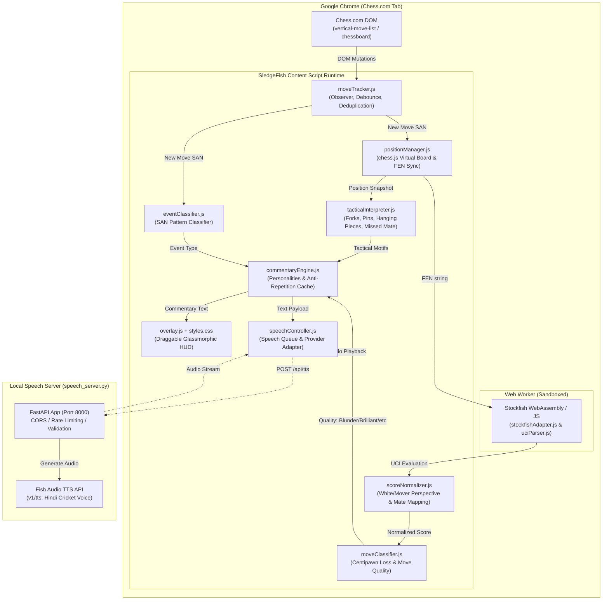
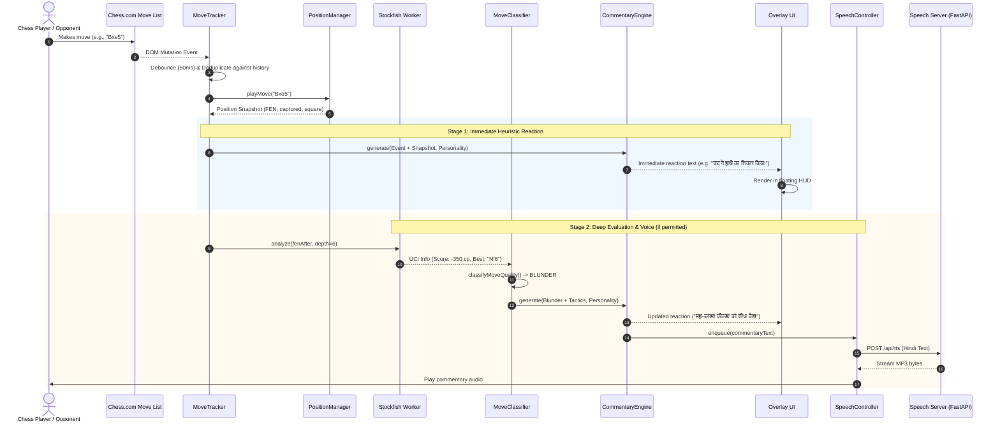

# SledgeFish System Design Document (SDD)

## 1. Executive Summary & Vision

**SledgeFish** is a real-time, personality-driven, contextual chess commentary system designed as a Google Chrome Extension (Manifest V3) paired with an optional low-latency Hindi voice synthesis server (FastAPI + Fish Audio).

While standard chess platforms (like Chess.com) focus purely on analytical centipawn graphs or generic move lists, SledgeFish introduces **theatrical, human-like, and culturally vibrant commentary** (stylized after passionate Hindi cricket broadcasts and witty trash talk). It monitors the board in real time, classifies tactical motifs and move quality, and surfaces witty commentary through an unobtrusive glassmorphic HUD and high-fidelity text-to-speech audio.

---

## 2. High-Level Architecture

The system is split into two primary operational tiers:
1. **Client Tier (Chrome Extension - Manifest V3)**: Autonomous, browser-embedded observation, move tracking, tactical interpretation, Stockfish engine analysis (in sandboxed worker), and floating HUD.
2. **Speech Service Tier (Optional Local Microservice)**: FastAPI backend proxying requests to the Fish Audio TTS API (`s2.1-pro` model) to protect API keys and stream audio without browser CORS issues.



---

## 3. Core Component Breakdown

### 3.1 Move Observation & Synchronization (`moveTracker.js`)
* **Purpose**: Observes Chess.com's dynamically rendered move list and board mutations.
* **Key Mechanics**:
  - **Selector Fallback Cascade**: Tracks `vertical-move-list`, `.vertical-move-list`, `wc-vertical-move-list`, `.move-list-component`, and chessboard containers.
  - **Zero Historical Spam**: On initial page load or mid-game attachment, performs a silent sync (`isInitialLoad: true`), seeding current moves without firing commentary.
  - **Rerender & Hover Resilience**: Chess.com frequently mutates the DOM during piece drags, square hover highlights, or clock ticks. `moveTracker` maintains an internal move array and debounces events (50ms) to ensure only genuine ply increments trigger notifications.
  - **Figurine Conversion**: Parses figurine `data-figurine` attributes and maps unicode chess figurines to standard SAN notation (e.g., `Nf3`, `Qxd5`).

### 3.2 Virtual Board & Position State (`positionManager.js` & `lib/chess.min.js`)
* **Purpose**: Maintains a deterministic, client-side mirror of the chess board state using `chess.js`.
* **State Snapshot Produced**:
  - `fenBefore` and `fenAfter`: Board representations in Forsyth–Edwards Notation.
  - `piece`, `from`, `to`, `captured`, `promotion`, `lan`: Detailed move semantics.
  - `legalMoves`: Complete list of legal follow-ups (used to detect forced moves).
  - `isCheck`, `isCheckmate`, `isDraw`: Explicit terminal flags.
  - Automatic desync recovery: If Chess.com board state diverges, rewinds and replays history cleanly from initial position.

### 3.3 Engine Analysis & Normalization (`engine/`, `scoreNormalizer.js`)
* **Stockfish Adapter (`stockfishAdapter.js`)**:
  - Instantiates Stockfish via Web Worker (`stockfish.worker.js` + `stockfish.wasm`).
  - Communicates via UCI (Universal Chess Interface).
  - Constrained search bounds (`depth: 6`, `movetime: 120ms`) to minimize CPU/battery consumption on client machines.
  - **Fair Play Policy**: Engine analysis is strictly scoped to bot play (`/play/computer/*`), analysis tabs (`/analysis/*`), or local practice. It is disabled during live human-vs-human rated games (`/game/live/*`).
* **UCI Parser (`uciParser.js`)**: Converts asynchronous engine stream lines (`info depth 6 score cp 45 pv ...`, `bestmove ...`) into structured JS objects.
* **Score Normalizer (`scoreNormalizer.js`)**:
  - Normalizes Stockfish scores (which are reported relative to the engine or side-to-move) into an absolute White perspective or relative Mover perspective.
  - Handles forced mate representations (`mate +N` / `mate -N`) cleanly without numeric overflow.
  - Calculates precise **Centipawn Evaluation Loss** across moves:
    $$\Delta CP = Score_{before}(mover) - Score_{after}(mover)$$

### 3.4 Move Quality & Tactical Motif Analysis (`moveClassifier.js`, `tacticalInterpreter.js`)
* **Move Quality Categorization**:
  - **BRILLIANT**: Material sacrifice with winning evaluation retention.
  - **EXCELLENT / BEST**: Engine best move or $\Delta CP \le 15$.
  - **GOOD**: Solid move ($15 < \Delta CP \le 40$).
  - **INACCURACY**: Minor loss ($40 < \Delta CP \le 100$).
  - **MISTAKE**: Noticeable error ($100 < \Delta CP \le 250$).
  - **BLUNDER**: Major error ($\Delta CP > 250$ or allowing forced mate).
  - **UNCLASSIFIED**: Fallback when engine is inactive or off.
* **Tactical Motif Detection**:
  - `HANGING_PIECE`: Valuable piece moved to or left on an attacked, undefended square.
  - `FORK`: A single piece (especially Knight or Pawn) attacking 2+ higher value pieces simultaneously.
  - `PIN`: Linear attack pinning a piece against King or Queen.
  - `MISSED_MATE`: Mover failed to execute an immediate 1-move checkmate.
  - `FREE_CAPTURE`: Material win with zero compensation.

### 3.5 Contextual Commentary Engine (`commentaryEngine.js`)
* **Cultural Flavor**: Witty Hindi commentary inspired by Indian cricket broadcasters (references to boundaries, helicopter shots, clean bowled, LBW, fielding lapses).
* **Supported Personalities**:
  1. 🔥 **Unhinged**: Chaotic, dramatic, hysterical overreactions.
  2. 😏 **Sarcastic**: Dry wit, cynical roasts, mocking blunders.
  3. 🎙️ **Professional**: Analytical, composed, sports-broadcaster tone.
  4. 🌱 **Supportive**: Warm, optimistic, praising tactical growth.
* **Anti-Repetition & Memory Buffer**:
  - Employs a rolling LRU history buffer (last 5 used lines per category).
  - Guarantees back-to-back similar events (e.g. repeated captures or quiet moves) never repeat the same line.

### 3.6 Speech Controller & Audio Queue (`speechController.js`)
* **Provider Pattern**: Decoupled `BaseSpeechProvider` interface allowing interchangeable TTS engines (Fish Audio, ElevenLabs, Web Speech API).
* **Audio Queue**:
  - Sequential play queue preventing overlapping voices.
  - Non-blocking: Network timeouts or server disconnections fail gracefully without stuttering the UI.
  - Mute/Unmute toggle with instant audio abort.

### 3.7 Local Speech Proxy (`speech_server.py`)
* **Tech Stack**: Python 3.10+, FastAPI, `httpx`, `uvicorn`.
* **Security & Reliability**:
  - Securely loads `FISH_API_KEY` from `.env`. Browser never sees the secret token.
  - Permissive CORS for Chrome Extension origins (`chrome-extension://*`).
  - Endpoints:
    - `GET /health`: Verifies server status and API key presence.
    - `POST /api/tts`: Validates text (max 2000 chars), proxies request to `https://api.fish.audio/v1/tts`, maps error codes (401 invalid key, 402 out of credits, 429 rate limit, 504 upstream timeout), and streams raw MP3 audio bytes.

### 3.8 User Interface & Overlay (`overlay.js`, `popup.html`, `styles.css`)
* **Design Aesthetic**: Glassmorphic dark HUD (`rgba(15, 23, 42, 0.85)` with `backdrop-filter: blur(12px)`).
* **Controls & Features**:
  - Floating, draggable header that preserves user placement.
  - Quick test button ("SF" logo) and Voice Sample test trigger.
  - Minimize / expand toggle to avoid obstructing chessboard action.
  - Dynamic personality badge and connection status pill.

---

## 4. Data Flow & Sequence Diagram



---

## 5. Security, Fair Play & Performance Engineering

| Vector | Challenge | Mitigation Strategy |
|---|---|---|
| **Fair Play Compliance** | Engines running during live matches can violate Chess.com Terms of Service | Stockfish execution is gated strictly to `/play/computer/*` and `/analysis/*`. During live human games, engine analysis is omitted; commentary runs purely on observable notation heuristics. |
| **Credential Security** | Leaking Fish Audio API key via client-side extension bundle | All API communication is routed through a local `speech_server.py` proxy. The extension only sends text payloads to `localhost:8000`. |
| **DOM Volatility** | Chess.com updates classes, renders animations, and alters DOM trees | Uses hierarchical selector cascades and multi-attribute fallbacks (`data-figurine`, text content, classes). |
| **Client Memory / CPU** | Heavy Stockfish analysis blocking the browser main thread | Stockfish runs in a dedicated Web Worker at shallow depth (6 plies) and short time limits (120ms), consuming <5% CPU. |
| **Network Resilience** | TTS API latency or internet downtime | Audio is purely additive. If the speech server or Fish Audio is unreachable, commentary text renders immediately without stutter or freezing. |

---

## 6. Directory Structure & File Map

```text
Chess_trash_Talk/
├── manifest.json              # Chrome Manifest V3 configuration & content script registration
├── content.js                 # Content script lifecycle coordinator & event loop
├── moveTracker.js             # DOM mutation listener, SAN extraction & deduplication
├── positionManager.js         # Virtual chess board representation powered by chess.js
├── eventClassifier.js         # Algebraic notation event parser (checks, mates, castling)
├── tacticalInterpreter.js     # Semantic tactical motif detector (forks, pins, hanging pieces)
├── moveClassifier.js          # Centipawn loss move quality evaluator (Blunder -> Brilliant)
├── scoreNormalizer.js         # UCI score parser and perspective transformer
├── commentaryEngine.js        # Personality templates (Hindi cricket flavor) & anti-repetition LRU
├── speechController.js        # Replaceable TTS provider adapter and sequential audio queue
├── overlay.js                 # Draggable glassmorphic floating HUD renderer
├── styles.css                 # HUD styling, animations, and badge styles
├── popup.html / popup.js      # Extension options and personality selector UI
├── speech_server.py           # FastAPI proxy for Fish Audio TTS API
├── package.json               # Node.js test scripts and dependencies
├── engine/
│   ├── stockfish.worker.js    # Stockfish Web Worker wrapper
│   ├── stockfish.wasm         # Stockfish 16+ WASM binary
│   ├── stockfishAdapter.js    # Engine promise wrapper & analysis coordinator
│   └── uciParser.js           # UCI stdout parser
├── lib/
│   └── chess.min.js           # Bundled Chess.js library for browser injection
└── tests/                     # Test suite (55 automated tests covering all modules)
```

---

## 7. Verification & Test Metrics

The system includes automated tests executed using Node.js's native test runner (`node:test`) and Python unit tests:

* **Total Test Suites**: 9 JS test files + Python API test.
* **Total Passing Tests**: 55 / 55 (100% pass rate).
* **Coverage**:
  - Move deduplication, initial load silence, and board resets (`moveTracker.test.js`).
  - Score normalizations, perspectives, and mate conversions (`scoreNormalizer.test.js`).
  - UCI string stream parsing and timeout cancellations (`stockfishAdapter.test.js`).
  - Positional validation, legal moves, and FEN tracking (`positionManager.test.js`).
  - Anti-repetition buffer and multilingual string templates (`commentaryEngine.test.js`).
  - Speech server endpoints, input validation, and upstream error mapping (`test_speech_server.py`).
